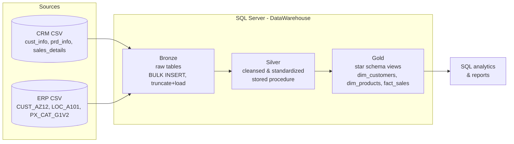
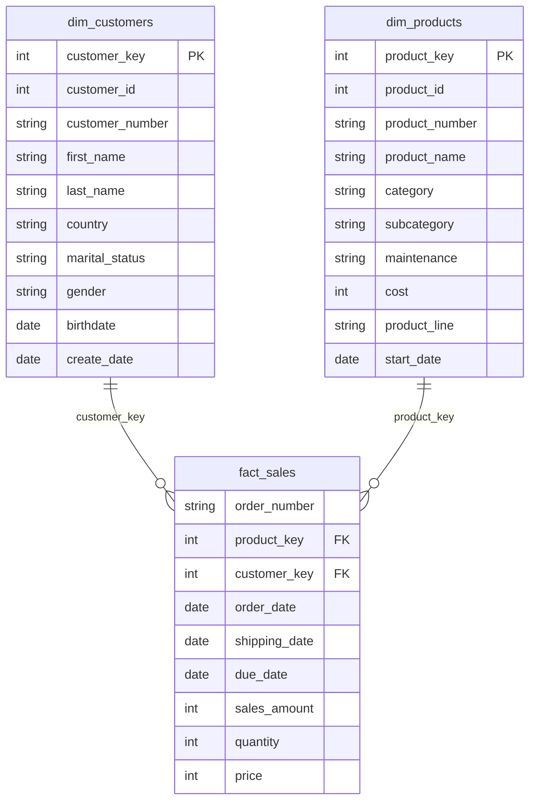
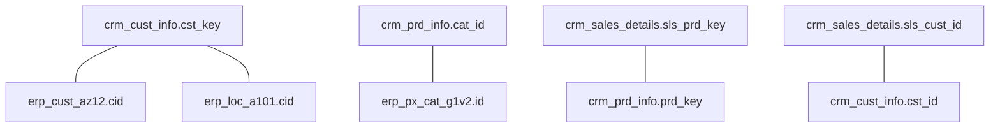

# Architecture - Medallion (Bronze / Silver / Gold)

| Layer | Object type | Load | Transformations | Purpose |
|---|---|---|---|---|
| Bronze | Tables | Full (truncate & insert) | None | Raw copy, traceability, debugging |
| Silver | Tables | Full (truncate & insert) | Cleansing, standardization, derived columns | Trusted, consistent data |
| Gold | Views | n/a | Integration, business rules, star schema | Analytics & reporting |

## Data model (Gold)

## Integration model (how sources join)

